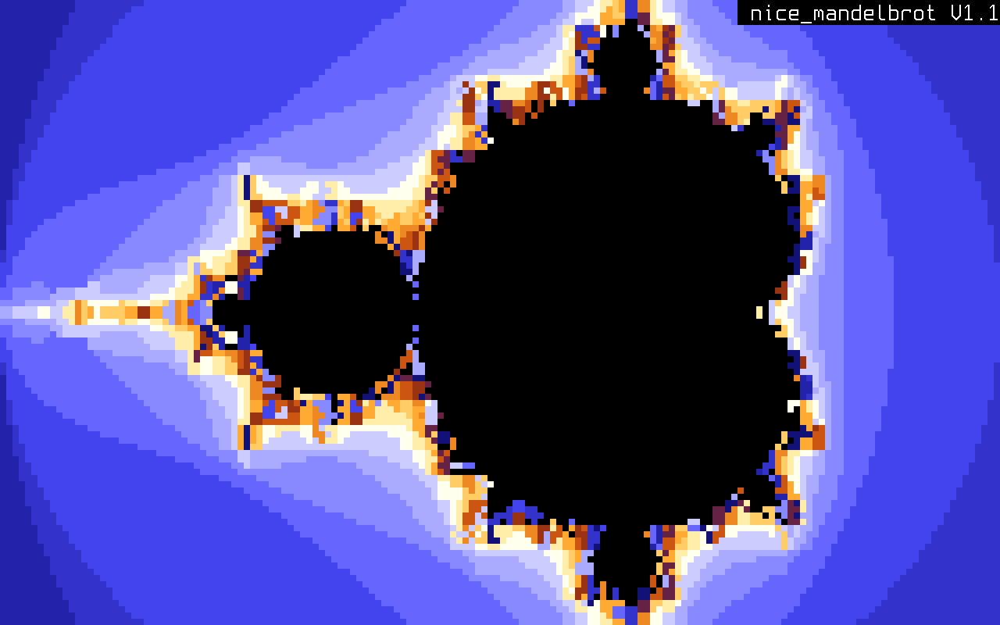
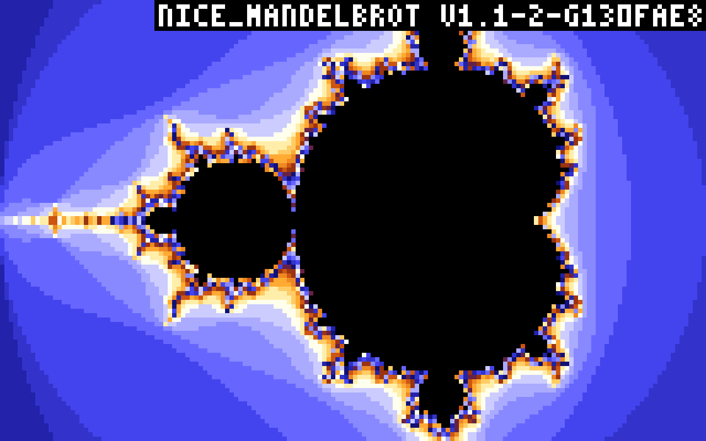

# nice_mandelbrot

The classic Mandelbrot rendering, on the NICE CPU.

The program runs on [NiceMonMEGA65](https://github.com/MJoergen/NiceMonMEGA65),
the [NICE CPU](https://github.com/MJoergen/nice_cpu) on the MEGA65, and in
`niceemu`. It is written in C first, and later in NICE BASIC, the
interpreter planned for the ROM of NiceMonMEGA65.

Stage 3 at 160×100, 1280×800 pixels, drawn from the screen that niceemu
dumps after the run, with the name and the version in the top right
corner.

## Download

Each [release](https://github.com/MJoergen/nice_mandelbrot/releases)
has one file for the MEGA65, such as `nice_mandelbrot_1.0.bin` of
V1.0: stage 2 up to V1.0, and stage 3 from the release after it. It needs the monitor of
NiceMonMEGA65 V2.1 or later. Stage 4, in the chunky mode, is not the
file of a release yet, as it needs NiceMonMEGA65 V2.3, which is not
released yet (The chunky mode, below). Copy it into the folder `NICE` of the SD
card, and at the monitor's prompt type

    load nice_mandelbrot_1.0.bin
    r

[RELEASE_NOTES.md](RELEASE_NOTES.md) lists what each release changed,
and [docs/RELEASE.md](docs/RELEASE.md) says how a release is made.

## The algorithm

Each point c of the complex plane is iterated by z ↦ z² + c, starting
from z = 0, until |z|² > 4 or a maximum count of iterations is reached.
The count gives the color of the point. Points that reach the maximum
are taken to be in the set, and are drawn black.

With z = x + iy and c = a + ib, one iteration is

    x2 = x·x
    y2 = y·y
    if x2 + y2 > 4 then stop
    y  = 2·x·y + b
    x  = x2 − y2 + a

that is three multiplications, and a few additions and a compare.

In C the numbers are 32-bit fixed point, with a few integer bits and the
rest fraction, and each product is a 64-bit product of the math unit
(MPU, nice_cpu's SYSTEM.md §2), shifted back. Fixed point keeps the
inner loop off the floating-point unit, whose `MUL` takes some 20 cycles.

## The resolutions

The screen is 80×25 characters, each 16×32 pixels, so 1280×800 pixels.
There are four stages:

| Stage | Resolution | How a point is drawn | Pixel shape on the screen |
|---|---|---|---|
| 1 | 80×25 | one character cell per point, its background color | 16×32 |
| 2 | 80×50 | a glyph of 2×1 blocks, the upper half block, in the font RAM | 16×16 |
| 3 | 160×100 | a font of 2×4 blocks, the octants, in the font RAM | 8×8 |
| 4 | 160×100 | one screen word per point, in the chunky mode of the screen | 8×8 |

In stage 1 the points are twice as tall as they are wide, so the step
in the imaginary direction is twice the step in the real one. In
stages 2 to 4 they are square, and the two steps are the same.

Stage 4 needs the chunky mode of the screen, which nice_cpu has from
V2.3 on (its DEVICES.md §1.10), and NiceMonMEGA65 from its V2.3 on, on
the MEGA65 only. **NiceMonMEGA65 V2.3 is not quite released yet**, so
for now stage 4 runs in niceemu, and on a MEGA65 with a build of
NiceMonMEGA65's `dev-V2.3`. Stages 1 to 3 run on NiceMonMEGA65 V2.1
and later, on the MEGA65 and the Nexys4DDR.

A font of 2×2 blocks, at 160×50, was planned for stage 3 at first. The
octants have the same width, twice the height, and square points, so
they took its place (issue #1).

### Colors in the 2×1 glyph

Stage 2 needs one glyph: the upper half block, its top 16 rows set and
its bottom 16 clear, which it writes over code `0x80` of the font RAM
(nice_cpu's SYSTEM.md §1.8), a blank in the character ROM. Each cell
is that glyph, in the top point's color as foreground, on the bottom
point's color as background. A cell has two points and two colors, so
the 80×50 image is exact everywhere.

### Colors in the octants

A cell of stage 3 has eight points, two across and four down. Point i,
row-major from the top left, is bit 7 − i of the cell's pattern, and a
set bit is drawn in the cell's foreground color, a clear bit in its
background color (nice_cpu's SYSTEM.md §1.8).

A screen word has only one foreground and one background color, so a
cell shows at most two colors, whatever its glyph. The program takes
the most frequent color of the eight points, and the most frequent of
the others, each the first in the order of the points when two are as
frequent. A point of a third color is drawn in the one of the two
nearer to it in RGB, the first of the two when they are as near. So
the image is exact where a cell's points have at most two colors, which
is most of the screen, and approximate along the bands where the colors
change quickly, near the border of the set. The rules are fixed, so
that the host computes the same screen as the NICE builds.

A pattern and its inverse, with the colors swapped, look the same, so
the program always draws the top-left point in the foreground: bit 7 is
set, and the glyph's code is the pattern itself, `0x80` to `0xFF`.
Those 128 glyphs replace codes `0x80`–`0xFF` of the copy of the
character ROM, and `0x00`–`0x7F` keep its ASCII for the label.

### The chunky mode

Stage 4 shows the same 160×100 points as stage 3, without the clash of
colors: in the chunky mode of the screen (nice_cpu's DEVICES.md §1.10,
issue #1), each of the 16 000 screen words is a point, a square of 8×8
pixels in the color of the word's bits 31..20. So the image is exact
everywhere, also along the border of the set. Stage 4 writes no font;
it only selects the mode.

The program writes 1 to the screen's mode word at `0xFFFFFF87` and
reads it back. A system without the mode, such as NiceMonMEGA65 before
V2.3, or the Nexys4DDR, which has too few screen words for it, reads 0.
The program then writes

    nice_mandelbrot stage 4: the screen has no chunky mode, which NiceMonMEGA65 has from V2.3 on, on the MEGA65

to the console and returns 1, and the screen stays as it was.

The font is not shown in the mode, so the label in the top right corner
is drawn in the points, in capitals of 3×5 points, white on black:
`NICE_MANDELBROT V1.0`.

## Estimated running times

The estimate counts iterations and the cycles of one iteration on the
pipelined core at 100 MHz.

**Iterations per point.** For the whole set, real part −2.0 to 1.0, with a
maximum of 256 iterations, about 21% of the points are in the set (its
area is about 1.5 of the 7.2 of the view) and take all 256 iterations.
The points outside escape after some 5 to 15 on average. That is about
65 iterations per point on average.

**Cycles per iteration.** Each multiplication through the MPU is two
writes, one or two reads, and a shift: some 6 to 8 cycles. With the
additions, the compare, and the loop, an iteration takes some 40 cycles
when written by hand, and some 60 (40 to 100) when compiled from C by
clang and `nicewasm`, which takes about 1.4 cycles per instruction on
the pipelined core. That is about 0.6 µs per iteration.

| Resolution | Points | Iterations | C (≈ 0.6 µs each) | NICE BASIC (≈ 20–30 µs each) |
|---|---|---|---|---|
| 80×25 | 2000 | 130 000 | ≈ 0.1 s (0.05–0.15) | ≈ 3–4 s |
| 80×50 | 4000 | 260 000 | ≈ 0.15 s (0.1–0.25) | ≈ 5–8 s |
| 160×50 | 8000 | 520 000 | ≈ 0.3 s (0.2–0.5) | ≈ 10–15 s |
| 160×100 | 16 000 | 1 040 000 | ≈ 0.6 s (0.4–1.0) | ≈ 20–30 s |

The BASIC column is the roughest. It assumes an interpreter that spends
some 1000 to 3000 cycles on each statement of the loop, with its numbers
on the FPU, so 30 to 50 times slower than C.

Notes on the estimate:

- The time grows linearly with the average count. A zoom near the
  border of the set, with a higher maximum, can take ten times as long.
- Most of the time goes to the points in the set. A test for the main
  cardioid and the period-2 bulb, before the loop, skips most of them.
  That turned out to be more than the half guessed here: the C programs
  have the test, and run the whole view some 5 times faster (Status,
  below).
- Drawing is not counted: 8000 screen writes, and the choice of two
  colors for each of 2000 cells, take a few milliseconds at most.
- The figures are to be checked against the performance counters
  (SYSTEM.md §3), which count cycles and microseconds on the board.

## Building and running

Stages 1 to 4 build with the toolchain of
[nice_cpu](https://github.com/MJoergen/nice_cpu) V2.3, which `make deps`
fetches into `deps/`, with niceemu from that release's files, and need
clang with the wasm32 target, `wasm-ld`, and `llvm-ar`. `NICE_CPU=DIR`
and `NICEEMU=PATH` use a local checkout and niceemu instead.

    make deps    # nice_cpu V2.3 and niceemu V2.3 into deps/
    make all     # build/nice/stageN.bin for niceemu, build/mega65/stageN.bin
                 # for the MEGA65's monitor at 0x8000, build/host/mandel_host
    make test    # both NICE builds of each stage in niceemu, their screens
                 # and glyphs or mode compared with the host's, also after a
                 # series of keys
    make run     # stage 2 in niceemu, its screen printed in color (STAGE=1, 3, or 4)
    make explore # stage 2 in niceemu's window, to pan and zoom (STAGE=3 or 4
                 # for stage 3 or 4; fetches niceemu's window build)
    make screenshot  # docs/stage2.png to docs/stage4.png, the screens in niceemu
                 # (needs Pillow)
    make dist    # build/dist/nice_mandelbrot_1.0.bin, the file of a release (VERSION=V1.0)

On the MEGA65 under NiceMonMEGA65's monitor, with a checkout of
NiceMonMEGA65 for its tools (`NICEMON=DIR`, `../NiceMonMEGA65` by
default), and the board on its Ethernet port (`ETH=IP`) or its debug
UART (`PORT=DEVICE`):

    make board-run       # stage 3 on the board (BOARD_STAGE=4 for stage 4)
    make board-test      # stages 2 to 4 on the board, their screens compared with the host's
    make release-check   # board-test, and the stamp of a release (docs/RELEASE.md)

Stage 4 of `board-test` needs NiceMonMEGA65 V2.3 on the MEGA65, with
the chunky mode.

Each program draws the picture a row of cells at a time, then writes
the iterations, cycles, instructions, and microseconds it took to the
console's line, and waits for a key. In stage 1, any key clears the
screen and returns. At the end of the console's input, as in niceemu,
it returns at once.

### Pan and zoom in stages 2 to 4

Stages 2 to 4 take these keys:

| Key | Action |
|---|---|
| ← → ↑ ↓ | Pan by a tenth of the width, 8 points in stage 2 and 16 in stages 3 and 4 |
| `+` or `=` | Zoom in, twice, about the middle |
| `-` or `_` | Zoom out, twice |
| `0` | The whole set again |
| `q` | Show the character ROM again, or the text in stage 4, clear the screen, and return |

The cursor keys are the xterm sequences `ESC [ A` to `ESC [ D`, which
niceemu's window and the MEGA65's keyboard send, and also `ESC O A` to
`ESC O D`. Other sequences, such as those of the function keys, do
nothing. After each row of cells, or of points in stage 4, the program reads the keys that wait,
and a key that moves the view starts the new picture at once. So a key
held down does not queue up pictures, and only whole pictures write
their figures.

Each zoom in halves the step between points, from 3/80 at the start
down to 2⁻²⁴, after 19 zooms, where the points are a step of the fixed
point apart. Stages 3 and 4 show the same part of the plane at each zoom,
with points half as far apart, from 3/160, so they reach 2⁻²⁴ after 18. Each also adds 64 to the highest count, 256 at the start,
so that the border of the set keeps its detail: 1472 at the deepest. One
zoom out from the start is allowed, to a width of 6, and the view stays
inside −4 to 4 on both axes, where the fixed point cannot overflow
(`src/mandel.h`).

Deep views take longer. The points of the main cardioid and the
period-2 bulb cost nothing (Status, below), but a view all inside
another part of the set, such as a small copy of it, at the deepest zoom
is 5.9 million iterations, some 4 s on the board. A key still takes
effect after the row of cells being drawn, some 0.2 s.

The files:

- `src/mandel.c`, `src/mandel.h`: the iteration, in fixed point with 25
  fraction bits, and the colors. On NICE each product is one of the math
  unit, through `nice_poke` and `nice_peek`; on the host it is a 64-bit
  product in C, with the same bits.
- `src/view.c`, `src/view.h`: the view of stages 2 to 4, and the keys
  that pan and zoom it, for NICE and for the host.
- `src/label.c`, `src/label.h`: the name and the version in the top
  right corner of stages 2 to 4, for NICE and for the host, in the ROM's
  letters, or in stage 4 in a font of 3×5 points. The version is
  `git describe`'s, in `build/gen/version.c`, or the tag's in a
  release.
- `src/stage1.c` to `src/stage4.c`: the stages, for
  NICE. The octants' colors and glyphs of stage 3 are in `src/mandel.c`
  and `src/mandel.h`, shared with the host.
- `src/report.c`, `src/report.h`: the figures of a run, written to the
  console's register, so that under the monitor they go to the line and
  not over the picture.
- `src/host.c`: the stages on the host, as characters, or as the
  screen words of the NICE builds, for `make test`. `--keys` applies a
  series of keys to the view of stages 2 to 4 first, and `--setup`
  prints the stage's glyphs in the font RAM, or the mode word of stage 4.
- `tools/screenshot.py`: a screen as a PNG, its cells drawn
  from the font RAM, or its points in the chunky mode, for `make screenshot`.
- `tools/words.py`: the words of a dump of niceemu or the board, by
  address, for the tests.
- `tools/board.py`: a program under the monitor on the board, as its
  console, with the screen dumped as niceemu dumps it, for
  `make board-test` (from nice_chess).
- `tools/release.py`: the scripted steps of a release (from
  nice_chess), [docs/RELEASE.md](docs/RELEASE.md).

## Status

Stages 1 to 4 are written and run in niceemu, stages 2 to 4 with pan
and zoom. Stage 3 is the file of a release; `make board-test` runs
stages 2 to 4 on the board, where stages 3 and 4 draw the whole set in
0.16 s and 0.15 s. Stage 4 has run on the MEGA65 with a build of
NiceMonMEGA65's `dev-V2.3`. The NICE BASIC version is not written yet.
In niceemu, stages 2 to 4 with the label of V1.0:

| Stage | Count | Per point | Instructions | At 54 million a second | Without the test |
|---|---|---|---|---|---|
| 1, 80×25 | 152 085 | 76 | 1 252 824 | ≈ 0.023 s | 6 077 411 |
| 2, 80×50 | 297 888 | 74 | 2 366 225 | ≈ 0.044 s | 11 937 338 |
| 3, 160×100 | 1 191 390 | 74 | 10 592 221 | ≈ 0.20 s | 49 041 256 |
| 4, 160×100 chunky | 1 191 390 | 74 | 9 773 295 | ≈ 0.18 s | 48 222 330 |

The count is the total of the points' counts, as the programs report it
under `iterations`: a point in the main cardioid or the period-2 bulb
counts as 256, though the test before the loop
(`src/mandel.c`) gives it at once. Without that test the programs run
about 40 instructions per iteration, and the test makes them some 5
times faster, with the same picture, word for word. In the view of
`make test` after the keys, near the border at zoom level 3, it is 15
times faster: 3 616 617 instructions, from 55 509 627, and in stage 3
14 times: 16 176 405, from 223 681 435, and in stage 4 too:
15 366 636, from 222 871 666. Stage 4 computes the points of stage 3,
and so has the same counts. The rate of 54
million instructions a second on the MEGA65 is the one nice_chess
measures.
Stages 2 and 3 also write the font RAM, 8192 words, before they start
the clock: stage 2 copies the character ROM, and stage 3 its first half
and the octants. Stage 4 writes no font, and needs no choice of two
colors a cell, so it runs some 8% fewer instructions than stage 3. The label in the
top right corner costs some 20 000 instructions a picture.

## License

See [LICENSE](LICENSE).
